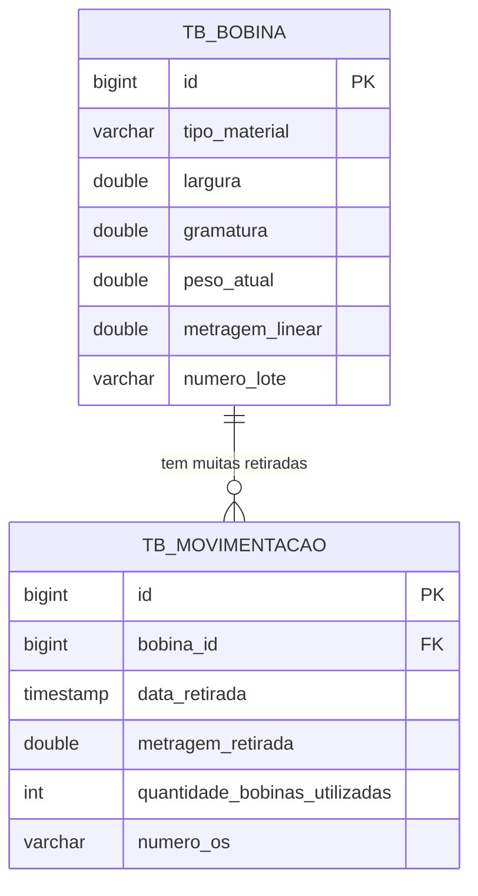

# Diagrama do banco: FlexoEstoque

Duas tabelas, ligadas por uma chave estrangeira (FK).



## Em texto

```
 TB_BOBINA                         TB_MOVIMENTACAO
 ┌──────────────────────┐          ┌──────────────────────────────────┐
 │ id (PK)              │◀─────────│ bobina_id (FK)                   │
 │ tipo_material        │   1   N  │ id (PK)                          │
 │ largura              │          │ data_retirada                    │
 │ gramatura            │          │ metragem_retirada                │
 │ peso_atual           │          │ quantidade_bobinas_utilizadas    │
 │ metragem_linear      │          │ numero_os                        │
 │ numero_lote          │          └──────────────────────────────────┘
 └──────────────────────┘
```

## Como ler

- **PK** (chave primária): identifica cada linha. O banco gera o número (`IDENTITY`).
- **FK** (chave estrangeira): `tb_movimentacao.bobina_id` guarda o `id` de uma bobina.
- **1 para N:** uma bobina pode ter **várias** retiradas. Cada retirada pertence a **uma** bobina.
- A relação existe **só de um lado** no código: a classe `MovimentacaoEstoque` conhece a `Bobina`, mas a `Bobina` não conhece suas movimentações.
